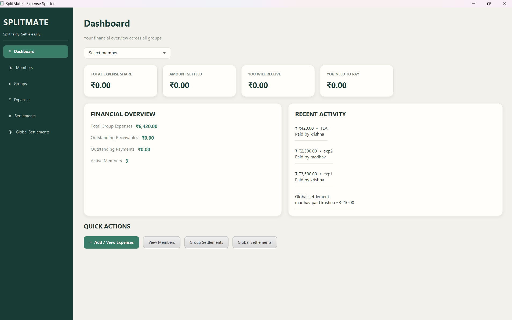
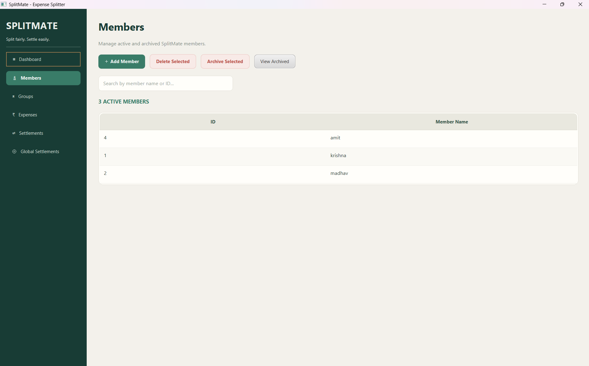
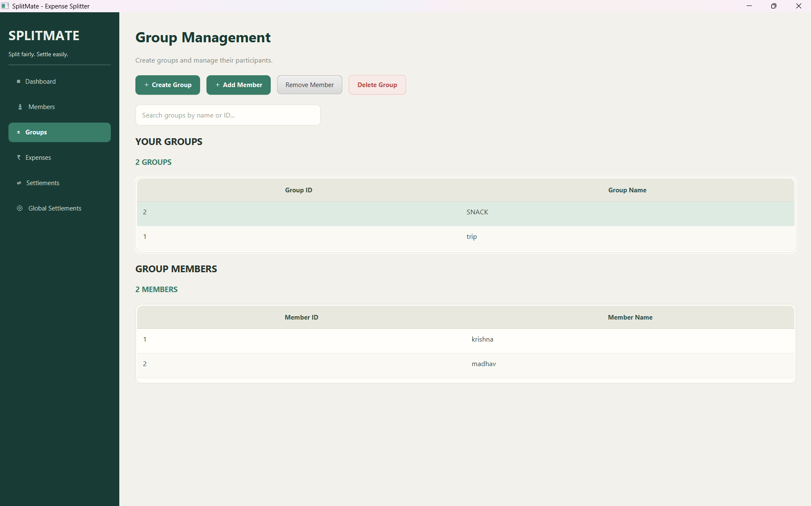
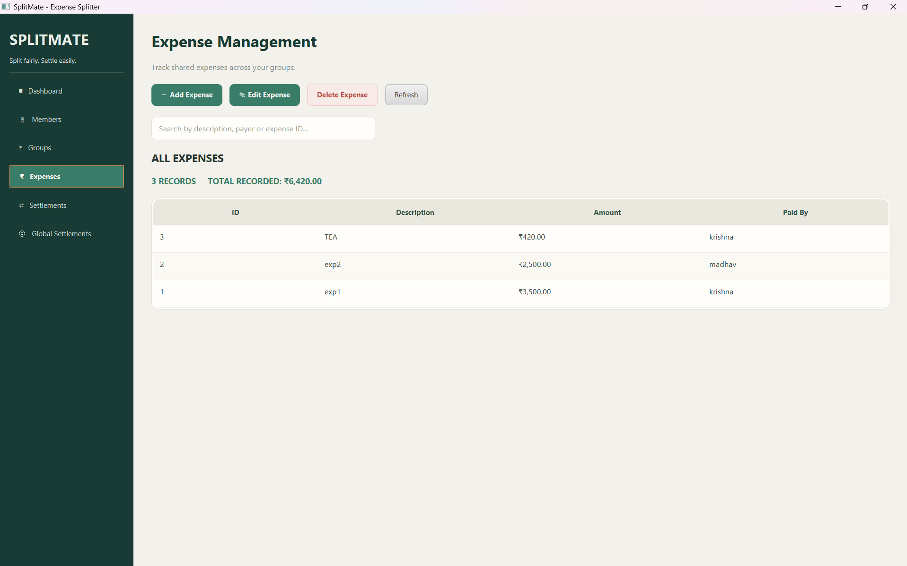
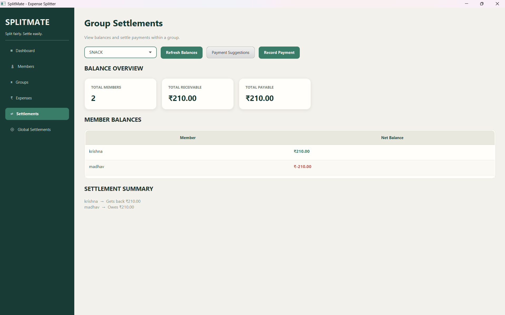
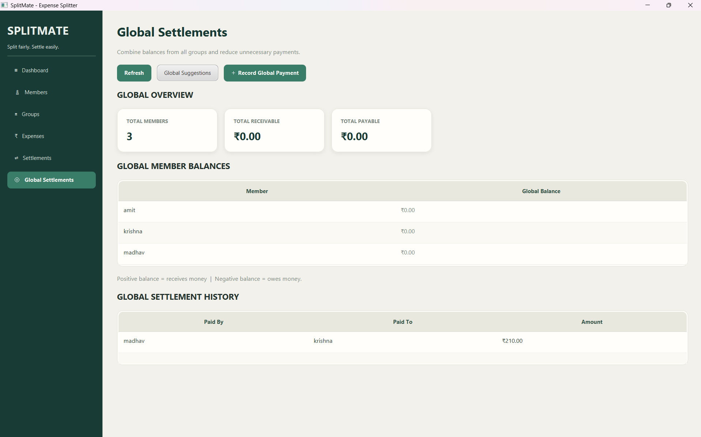

# 💰 SplitMate – Smart Expense Splitter

**SplitMate** is a desktop-based expense management and splitting application developed using Java and JavaFX. It helps individuals and groups manage shared expenses, calculate balances, track payments and simplify financial settlements.

The application uses SQLite for persistent data storage and provides an interactive graphical interface for managing members, groups, expenses and settlements.

---

## ✨ Features

### 1. Dashboard
- Overview of total expense shares.
- Track amounts settled.
- View amounts to receive and amounts to pay.
- Member-wise financial summary.

### 2. Member Management
- Add and manage members.
- Archive and restore members.
- Delete members when permitted.
- Maintain historical financial records.

### 3. Group Management
- Create and manage expense groups.
- Add and remove members from groups.
- Manage group membership.
- Delete groups.

### 4. Expense Management
- Add, edit and delete expenses.
- Assign expenses to a particular payer.
- Split expenses among selected participants.
- Support equal and custom expense splitting.
- Search and filter expense records.
- Preserve existing custom shares when editing expenses.

### 5. Group Settlements
- Calculate individual group balances.
- Identify who owes money and who should receive money.
- View settlement suggestions.
- Record payments between group members.

### 6. Global Settlements
- Calculate balances across all groups.
- Identify overall receivables and payables.
- Generate global settlement suggestions.
- Record payments between members.
- Maintain global settlement history.

### 7. Additional Features
- Persistent database storage using SQLite.
- Indian Rupee (₹) currency formatting.
- Transaction-based database operations.
- User-friendly graphical interface.
- Separate service classes for business logic.

---
---

## 📸 Application Screenshots

### Dashboard


### Member Management


### Group Management


### Expense Management


### Group Settlements


### Global Settlements


---
## 🛠️ Technology Stack

| Technology | Purpose |
|---|---|
| Java | Core application development |
| JavaFX | Graphical User Interface |
| SQLite | Database management |
| JDBC | Database connectivity |
| Maven | Dependency and project management |
| CSS | Application styling |
| Git & GitHub | Version control and source code hosting |

---

## 🏗️ Project Architecture

SplitMate follows a layered application structure that separates the user interface, data models, business logic and database operations.

```text
SplitMate/
│
├── pom.xml
├── .gitignore
├── splitmate.db
│
└── src/
    └── main/
        ├── java/
        │   └── com/
        │       └── splitmate/
        │           │
        │           ├── App.java
        │           │
        │           ├── database/
        │           │   ├── DatabaseConnection.java
        │           │   └── DatabaseInitializer.java
        │           │
        │           ├── models/
        │           │   ├── Member.java
        │           │   ├── Group.java
        │           │   └── Expense.java
        │           │
        │           └── services/
        │               ├── MemberService.java
        │               ├── GroupService.java
        │               ├── ExpenseService.java
        │               ├── BalanceService.java
        │               ├── SettlementService.java
        │               └── GlobalSettlementService.java
        │
        └── resources/
            └── css/
                └── app.css
```

### Architecture Components

- **App.java:** Handles the JavaFX interface, navigation and user interactions.
- **Models:** Represent application entities such as members, groups and expenses.
- **Services:** Handle business logic, expense calculations, balance management and settlements.
- **Database:** Manages SQLite connectivity and database initialization.
- **CSS:** Defines the application's visual appearance and styling.

---

## ⚙️ Installation and Setup

### Prerequisites

Make sure you have installed:

- Java Development Kit (JDK 26 or compatible version)
- Apache Maven 3.10.0 or compatible version
- Git
- JavaFX dependencies (managed through Maven)

### 1. Clone the Repository

```bash
git clone https://github.com/Githacker-09/SplitMate.git
```

### 2. Navigate to the Project Directory

```bash
cd SplitMate
```

### 3. Compile the Application

```bash
mvn clean compile
```

### 4. Run the Application

```bash
mvn javafx:run
```

The SplitMate desktop application should now launch.

---

## 🗄️ Database

SplitMate uses SQLite as its database.

The database stores application information and supports persistent management of:

- Members
- Groups
- Expenses
- Expense splits
- Group settlements
- Global settlements

Database connectivity and initialization are handled through dedicated Java classes.

---

## 💡 How It Works

1. Add members to the application.
2. Create groups and assign members.
3. Record expenses and select the person who paid.
4. Choose participants and split the expense equally or using custom shares.
5. View individual balances.
6. Use settlement suggestions to identify payments.
7. Record settlements and track updated balances.

---

## 🔮 Future Enhancements

Potential future improvements include:

- Export expense and settlement reports.
- PDF generation for financial summaries.
- Advanced analytics and spending visualizations.
- User authentication and role-based access.
- Cloud synchronization and multi-device support.
- Automated backup and restore functionality.

---

## 👨‍💻 Developer

**Developed as an academic software development project.**

**Project:** SplitMate – Smart Expense Splitter  
**Repository:** [Githacker-09/SplitMate](https://github.com/Githacker-09/SplitMate)

---

## 📄 License

This project is currently available for educational and demonstration purposes.
